# Electric Load Forecasting on Azure: Data Lake, Data Factory & Azure Machine Learning

> End-to-end report of an hourly electricity-consumption forecasting project: raw data ingestion into a Data Lake with Azure Data Factory, then data preparation, feature engineering, training and evaluation of two regression models with Azure Machine Learning Designer.

---

## Table of Contents

1. [Architecture overview](#architecture-overview)
2. [Project resources](#project-resources)
3. [Étape 1: Data Lake configuration (ADLS Gen2)](#étape-1-data-lake-configuration-adls-gen2)
4. [Étape 2: Automated ingestion with Azure Data Factory](#étape-2-automated-ingestion-with-azure-data-factory)
5. [Étape 3: Azure Machine Learning setup](#étape-3-azure-machine-learning-setup)
6. [Étape 4: Registering the Data Asset](#étape-4-registering-the-data-asset)
7. [Étape 5: Designer pipeline and data import](#étape-5-designer-pipeline-and-data-import)
8. [Étape 6: Data cleaning and profiling](#étape-6-data-cleaning-and-profiling)
9. [Étape 7: Temporal feature engineering with Python](#étape-7-temporal-feature-engineering-with-python)
10. [Étape 8: Feature selection, split, training and evaluation](#étape-8-feature-selection-chronological-split-training-and-evaluation)
11. [Results](#results)
12. [Conclusion](#conclusion)

---

## Architecture overview

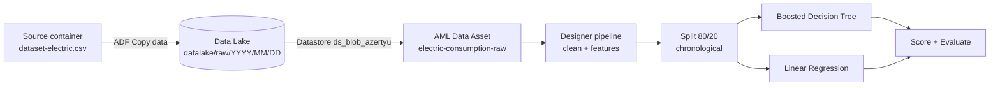

---

## Project resources

| Parameter | Value |
| :--- | :--- |
| **Subscription** | `formation-devops-simplon` |
| **Resource group** | `artiKara` |
| **Region** | North Europe |
| **Storage account (ADLS Gen2)** | `azertyu` |
| **Source file** | `dataset-electric.csv` (columns: `Datetime`, `PJME_MW`) |
| **Target Data Lake container** | `datalake` |
| **Raw partition path** | `datalake/raw/2026/11/25/dataset-electric.csv` |
| **Azure Data Factory** | `factoryazerty` |
| **Linked service** | `ls_adls_azertyu` |
| **Datasets** | `ds_source_electric_csv`, `ds_sink_raw_datalake` |
| **Pipeline (ADF)** | `pipeline1` (activity `Copy data1`) |
| **Azure ML workspace** | `mlw-artikara-forecast` |
| **Compute cluster** | `cpu-cluster-forecast` (`Standard_D2s_v3`, 0 to 2 nodes) |
| **AML datastore** | `ds_blob_azertyu` |
| **AML data asset** | `electric-consumption-raw` |
| **Designer pipeline / experiment** | `electric-load-forecasting-training` / `exp-electric-forecast` |

---

## Étape 1: Data Lake configuration (ADLS Gen2)

**Goal:** have a storage account with hierarchical namespace enabled (Data Lake Gen2) holding the source CSV and a dedicated `datalake` container.

### 1.1 Create the storage account

The storage account `azertyu` is created in resource group `artiKara`, region North Europe, with Standard performance and locally redundant storage (LRS).

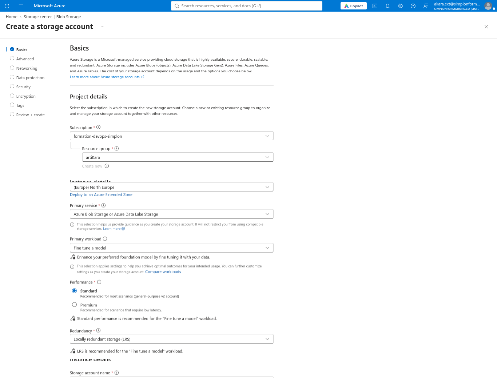

In the **Advanced** tab, **Enable hierarchical namespace** is checked. This is what turns a Blob storage account into a Data Lake Storage Gen2 account.

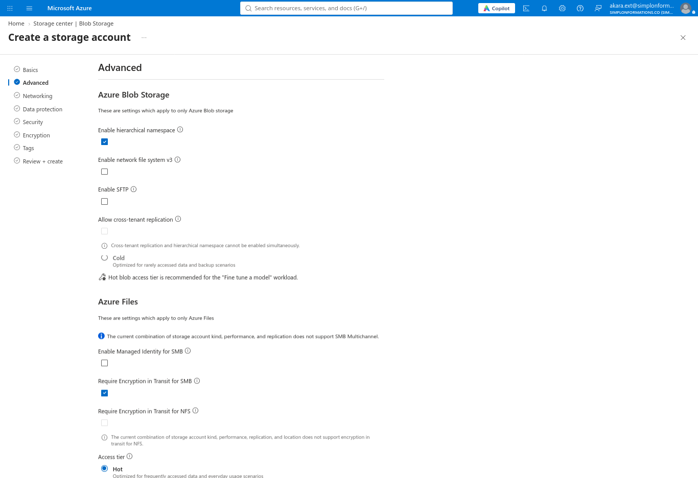

The **Review + create** page confirms the configuration (Hierarchical namespace: Enabled).

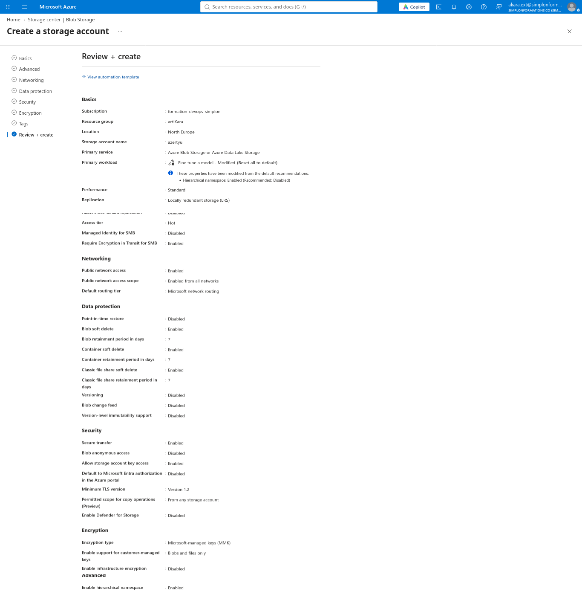

Once validated, the deployment completes.

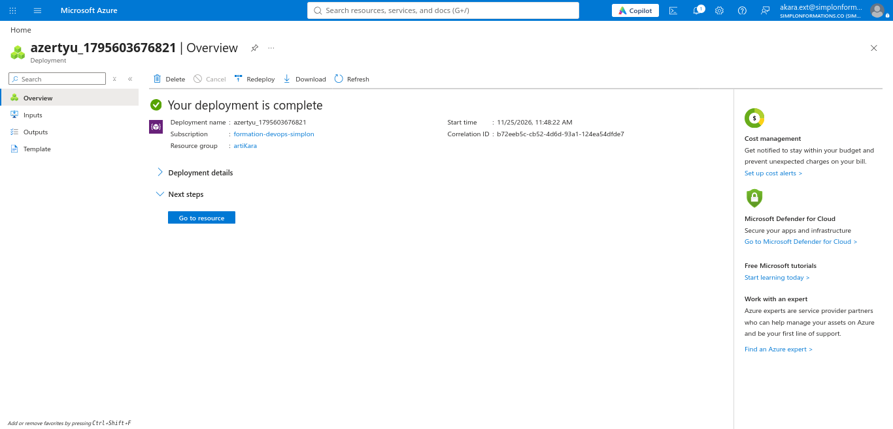

### 1.2 Verify the containers and the source data

Under **Data storage → Containers**, the existing containers are visible, all with private access.

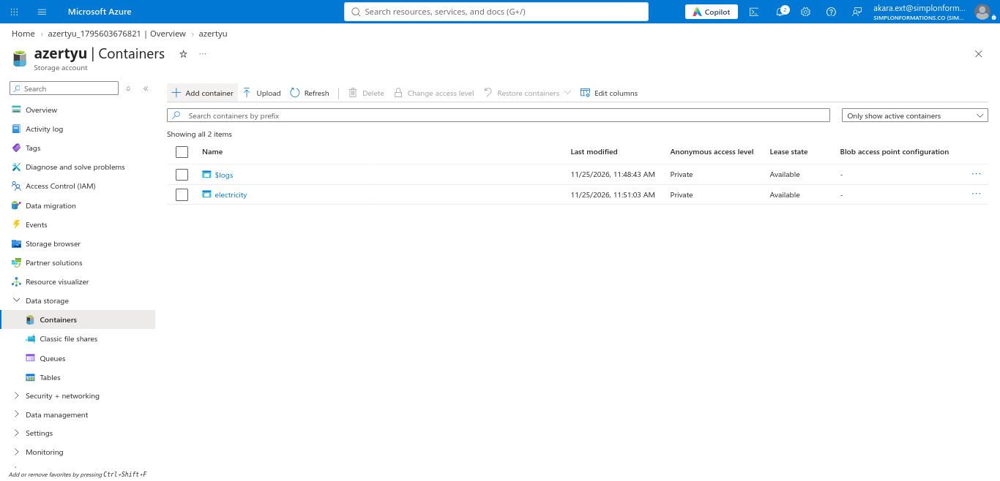

The raw dataset `dataset-electric.csv` (3.88 MiB) is present in the source container.

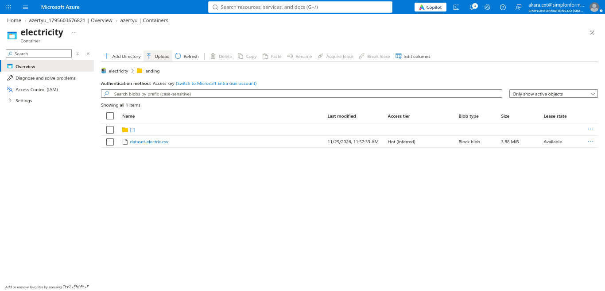

### 1.3 Create the `datalake` container

A new container named **`datalake`** is created with **Private** anonymous access. The `raw/YYYY/MM/DD/` sub-folders are not created by hand; they are generated dynamically by the pipeline at run time (see Étape 2).

---

## Étape 2: Automated ingestion with Azure Data Factory

**Goal:** copy the CSV from the source container into a date-partitioned folder of the Data Lake.

### 2.1 Linked service `ls_adls_azertyu`

In Data Factory Studio (**Manage → Linked services → New**), an **Azure Data Lake Storage Gen2** linked service is created:

- Integration runtime: `AutoResolveIntegrationRuntime`
- Authentication: Account key, selected from the Azure subscription
- Storage account: `azertyu`
- **Test connection** returned *Connection successful*

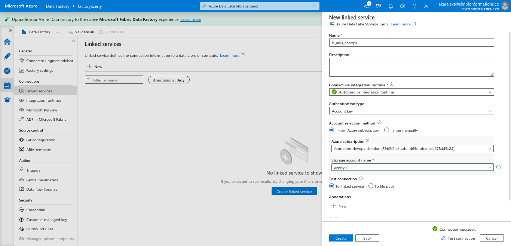

### 2.2 Datasets

Two **DelimitedText** datasets are created in the **Author** hub, both using `ls_adls_azertyu` with *First row as header* checked:

| Dataset | Role | Location |
| :--- | :--- | :--- |
| `ds_source_electric_csv` | Source | Source container / `dataset-electric.csv` |
| `ds_sink_raw_datalake` | Sink | `datalake` / dynamic directory / `dataset-electric.csv` |

The sink directory uses dynamic content, so each run writes to a folder named after the current UTC date:

```text
raw/@{formatDateTime(utcnow(), 'yyyy/MM/dd')}
```

For the sink, **Import schema** is set to `None` because the date-partitioned folder does not exist before the first run.

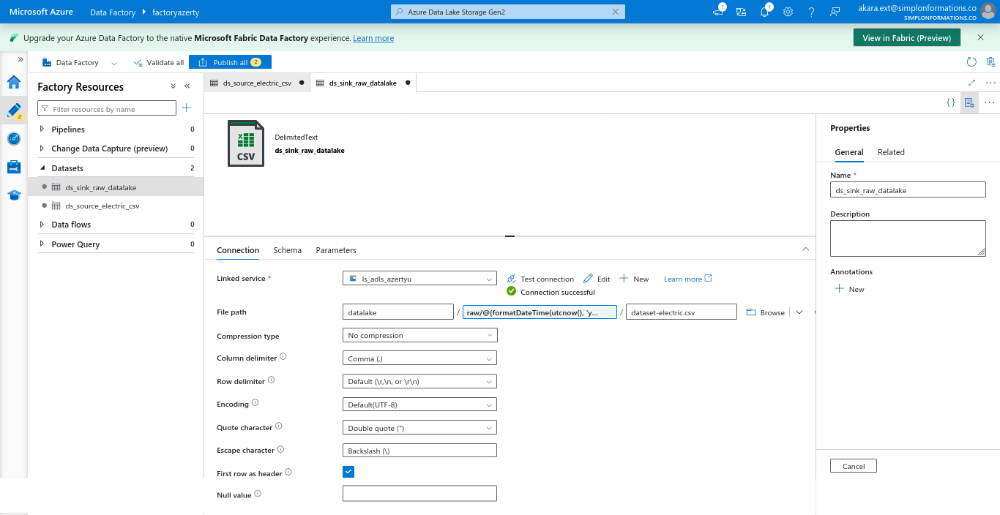

### 2.3 Pipeline `pipeline1`

A **Copy data** activity (`Copy data1`) is added to `pipeline1`:

- **Source:** `ds_source_electric_csv`
- **Sink:** `ds_sink_raw_datalake`
- **Mapping:** *Import schemas*, giving `Datetime → Datetime` and `PJME_MW → PJME_MW`

**Validate** reported no errors. **Debug** ended with **Pipeline status: Succeeded** (about 18 s).

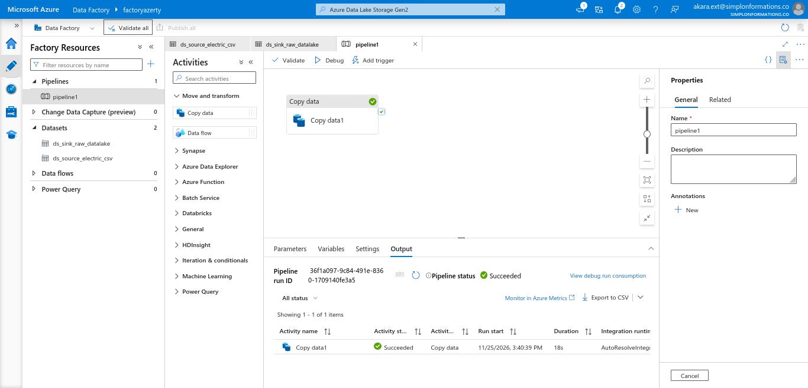

After **Publish all**, the run also appears in the **Monitor** hub with the activity `Copy data1` marked *Succeeded*.

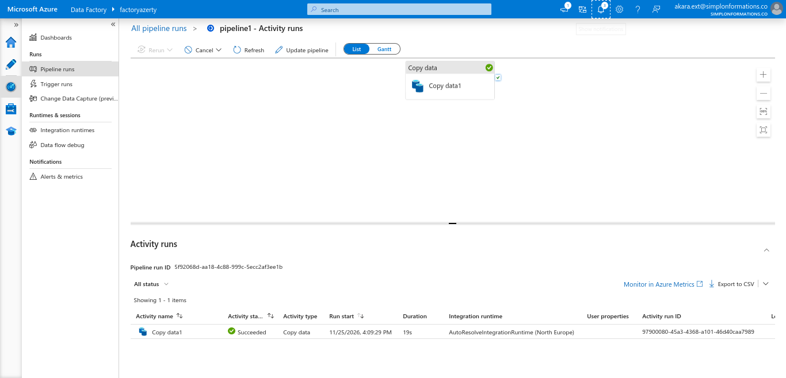

### 2.4 Result in the Data Lake

The file landed in the expected partition `datalake/raw/2026/11/25/dataset-electric.csv` (4.57 MiB).

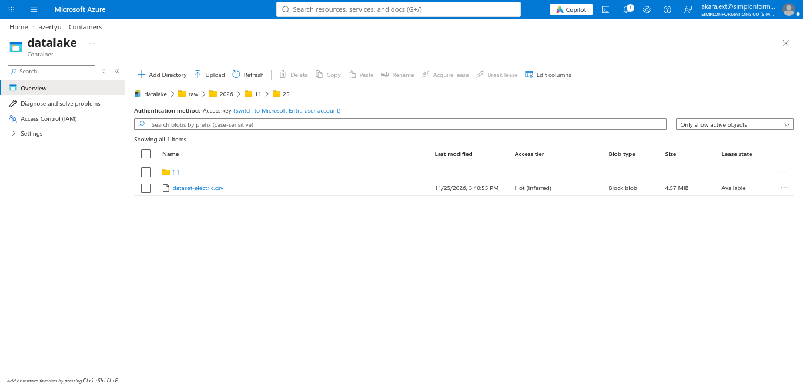

---

## Étape 3: Azure Machine Learning setup

### 3.1 Create the workspace

From the Azure Portal, an **Azure Machine Learning** workspace is created in resource group `artiKara` (North Europe). Its Key Vault, storage account and Log Analytics workspace are auto-generated, and no container registry is attached.

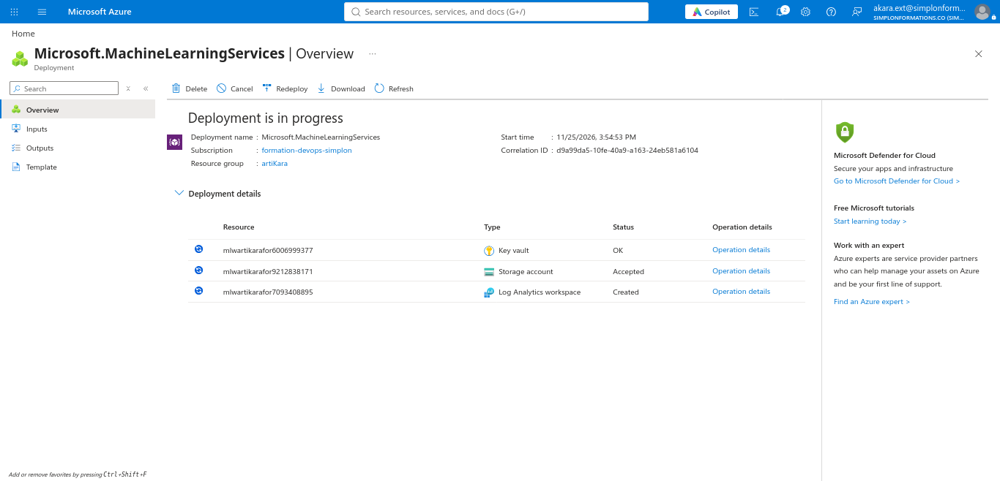

The workspace is then opened with **Launch studio** (`ml.azure.com`).

### 3.2 Compute cluster `cpu-cluster-forecast`

In **Manage → Compute → Compute clusters → New**:

| Setting | Value |
| :--- | :--- |
| Tier | Dedicated |
| VM size | `Standard_D2s_v3` (2 cores, 8 GB RAM, 16 GB storage) |
| Minimum nodes | 0 (scales to zero when idle, so no idle cost) |
| Idle seconds before scale down | 120 |

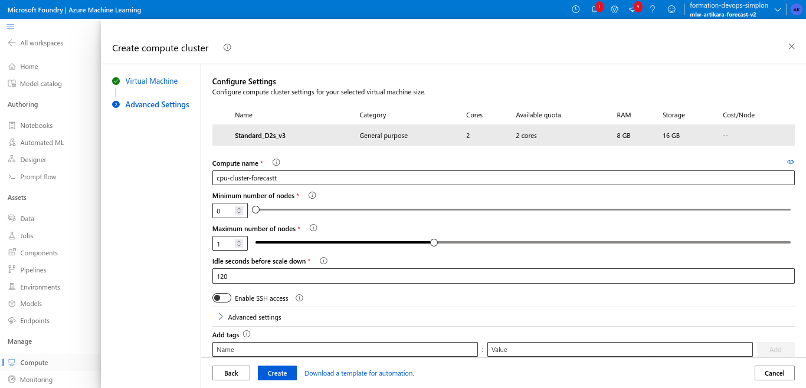

### 3.3 Datastore `ds_blob_azertyu`

In **Assets → Data → Datastores → Create**, the Data Lake is connected to the workspace as an **Azure Blob Storage** datastore, using the storage account `azertyu`, the container `datalake` and **Account key** authentication (key taken from *Security + networking → Access keys*). The datastore then appears in the list.

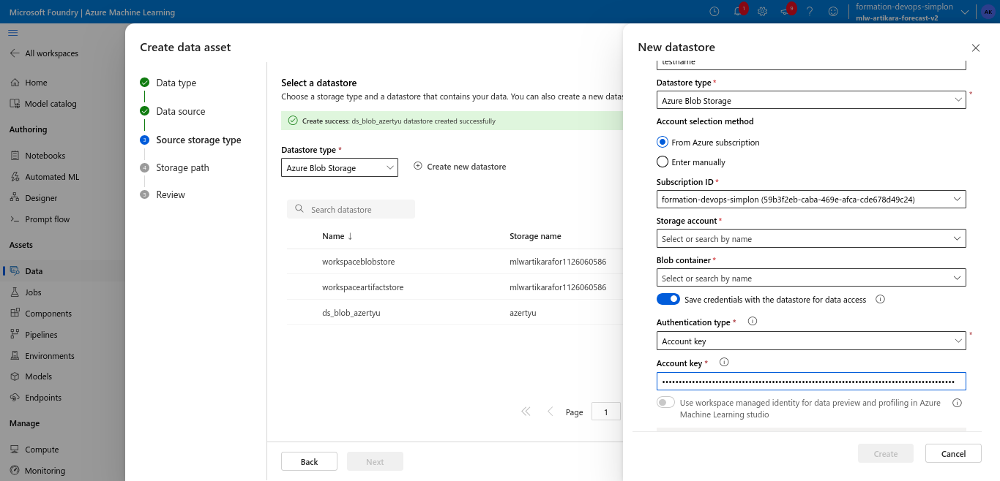

---

## Étape 4: Registering the Data Asset

In **Assets → Data → Data assets → Create**, the raw file is registered:

- **Name:** `electric-consumption-raw`
- **Type:** File (`uri_file`)
- **Source:** From Azure storage, datastore `ds_blob_azertyu`
- **Path:** `raw/2026/11/26/dataset-electric.csv`

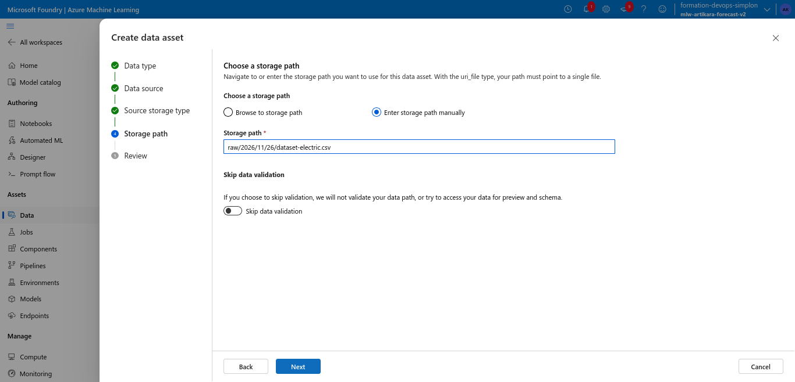

The asset is created as version 1 and points to the datastore `ds_blob_azertyu`.

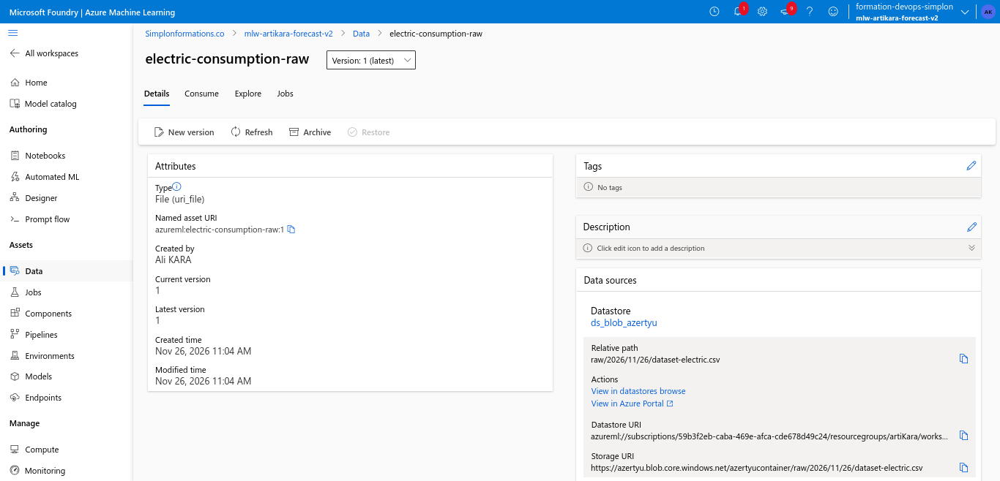

---

## Étape 5: Designer pipeline and data import

In **Authoring → Designer**, a new pipeline is created with classic prebuilt components and renamed **`electric-load-forecasting-training`**.

The **Import Data** component is configured with:

- **Data source:** Datastore
- **Datastore:** `ds_blob_azertyu`
- **Path:** `raw/2026/11/26/dataset-electric.csv`

The component shows the **Validated** badge. It is visible at the top of the canvas in the next screenshots.

---

## Étape 6: Data cleaning and profiling

Four components are chained after `Import Data`:

| Component | Purpose | Key settings |
| :--- | :--- | :--- |
| **Summarize Data** | Descriptive statistics on the raw data (count, missing values, min, max, mean, std) | Connected to `Import Data` |
| **Clean Missing Data** | Handle missing values | All columns, ratio 0.0 to 1.0, mode **Remove entire row** |
| **Remove Duplicate Rows** | Deduplicate timestamps | Key column `Datetime`, keep first duplicate |
| **Edit Metadata** | Cast timestamp type | Column `Datetime`, type `DateTime` |

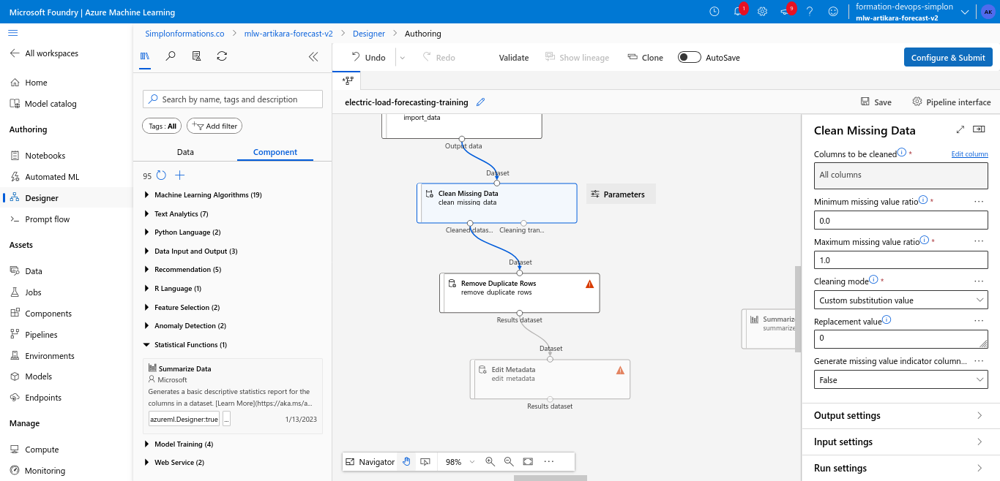

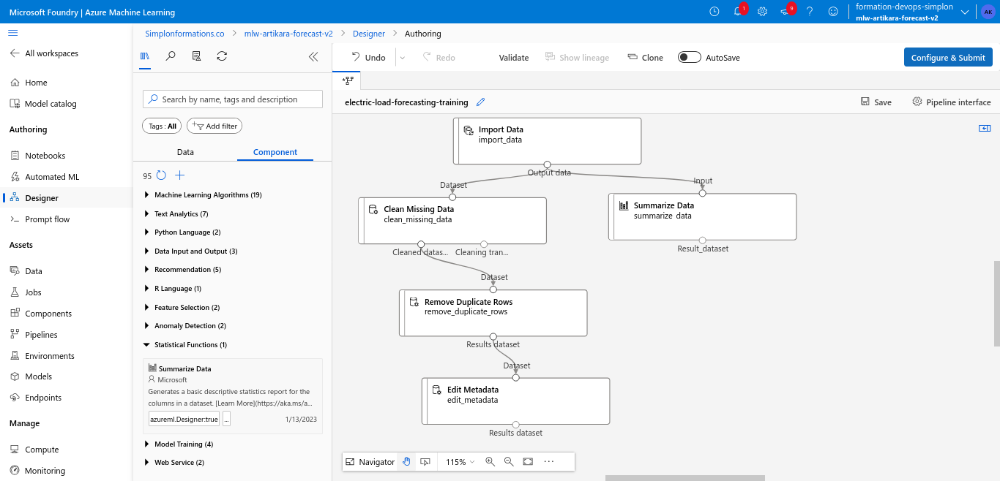

---

## Étape 7: Temporal feature engineering with Python

An **Execute Python Script** component, connected after `Edit Metadata`, sorts the series chronologically and builds calendar, lag and rolling-window features. The rolling mean is computed on the series shifted by one step, so no future value leaks into a row's features.

```python
import pandas as pd

def azureml_main(dataframe1=None, dataframe2=None):
    df = dataframe1.copy()
    df['Datetime'] = pd.to_datetime(df['Datetime'])
    df = df.sort_values('Datetime').reset_index(drop=True)

    # Temporal / calendar features
    df['hour'] = df['Datetime'].dt.hour
    df['dayofweek'] = df['Datetime'].dt.dayofweek
    df['month'] = df['Datetime'].dt.month
    df['quarter'] = df['Datetime'].dt.quarter
    df['dayofyear'] = df['Datetime'].dt.dayofyear
    df['is_weekend'] = (df['dayofweek'] >= 5).astype(int)

    # Autoregressive lag and shifted rolling-mean features
    df['lag_1'] = df['PJME_MW'].shift(1)
    df['lag_24'] = df['PJME_MW'].shift(24)
    df['lag_168'] = df['PJME_MW'].shift(168)
    df['rolling_mean_24'] = df['PJME_MW'].shift(1).rolling(window=24).mean()

    df = df.dropna().reset_index(drop=True)
    return df,
```

| Feature type | Columns |
| :--- | :--- |
| Calendar | `hour`, `dayofweek`, `month`, `quarter`, `dayofyear`, `is_weekend` |
| Lag | `lag_1` (1 h), `lag_24` (1 day), `lag_168` (1 week) |
| Rolling | `rolling_mean_24` |

---

## Étape 8: Feature selection, chronological split, training and evaluation

### 8.1 Column selection

**Select Columns in Dataset** excludes the raw `Datetime` column. The remaining columns are the target `PJME_MW` and the 10 engineered numeric features.

### 8.2 Chronological split

**Split Data** keeps the time order to avoid data leakage:

| Parameter | Value |
| :--- | :--- |
| Splitting mode | Split Rows |
| Fraction in first output | `0.8` (80% training, the oldest data) |
| Randomized split | `False` |
| Random seed | `0` |
| Stratified split | `False` |

### 8.3 Two models trained in parallel

| Branch | Algorithm | Role |
| :--- | :--- | :--- |
| 1 | Boosted Decision Tree Regression | Main model |
| 2 | Linear Regression | Baseline |

Each algorithm feeds a **Train Model** component (label column `PJME_MW`) fed by the 80% output of `Split Data`. Each trained model goes into a **Score Model** with the 20% test output, and both scored datasets feed one **Evaluate Model** component.

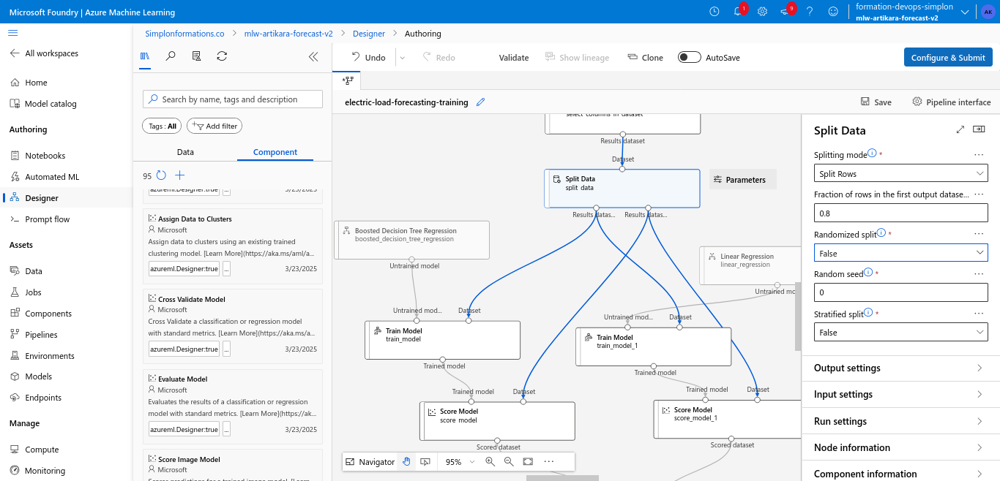

### 8.4 Submitting the job

After **Validate** (*"The pipeline looks good"*) and **Save**, the job is launched from **Configure & Submit**:

- **Experiment:** `exp-electric-forecast`
- **Compute:** compute cluster `cpu-cluster-forecast`
- **Default datastore:** `workspaceblobstore`

The job finished with the status **Completed**, all components showing a green check.

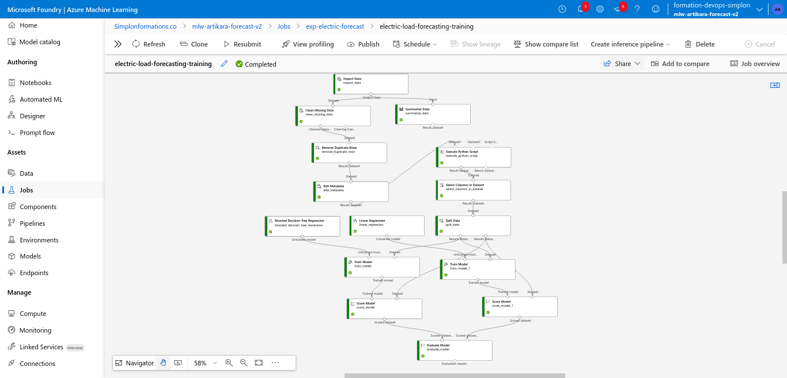

---

## Results

The **Evaluate Model** output compares the two models on the 20% test set (first row: Boosted Decision Tree, second row: Linear Regression).

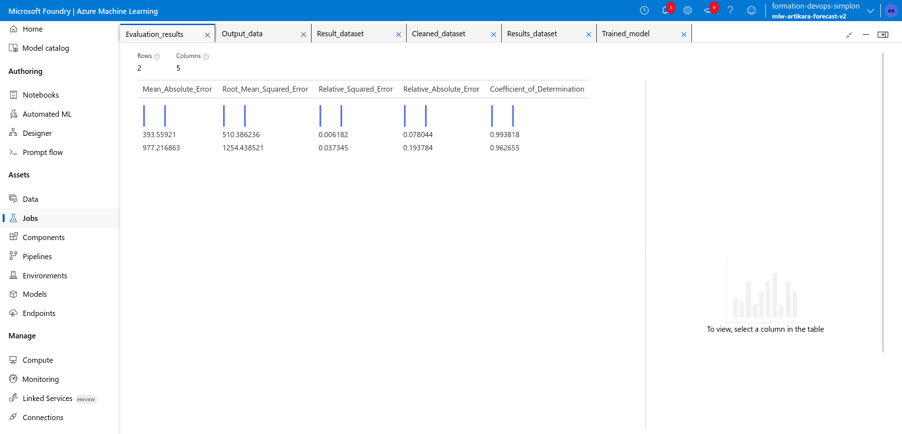

| Metric | Boosted Decision Tree | Linear Regression (baseline) |
| :--- | ---: | ---: |
| Mean Absolute Error (MAE) | **393.56** | 977.22 |
| Root Mean Squared Error (RMSE) | **510.39** | 1254.44 |
| Relative Absolute Error (RAE) | **0.0780** | 0.1938 |
| Relative Squared Error (RSE) | **0.0062** | 0.0373 |
| Coefficient of Determination (R²) | **0.9938** | 0.9627 |

**Reading:** the Boosted Decision Tree cuts the MAE by about 60% compared with the linear baseline (393.6 MW against 977.2 MW) and explains 99.4% of the variance on unseen data. Both models score well because the lag features (`lag_1`, `lag_24`, `lag_168`) carry most of the signal in a strongly autocorrelated load series.

---

## Conclusion

The pipeline covers the full chain:

1. A Gen2 Data Lake with a date-partitioned `raw` zone, filled automatically by Azure Data Factory.
2. An Azure ML workspace connected to that lake through a datastore and a versioned data asset.
3. A reproducible Designer pipeline for cleaning, feature engineering, chronological splitting, training and evaluation.
4. A clear model comparison, with the Boosted Decision Tree outperforming the linear baseline on every metric.

